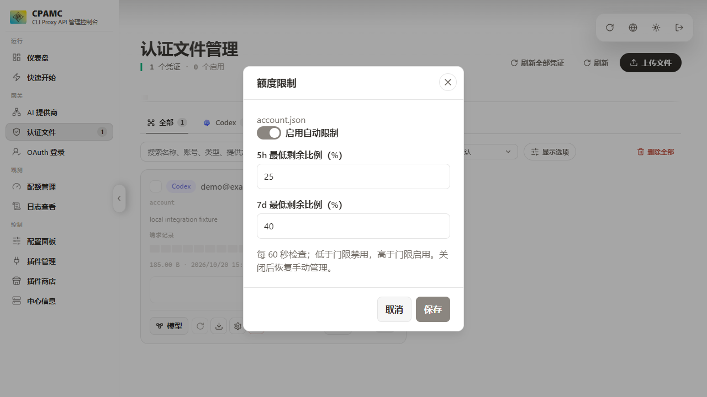

# CPA 账号额度限制插件

为 CLIProxyAPI 的 Codex 订阅账号设置 5h、7d 最低剩余额度比例，在认证文件右侧增加“限制”按钮。

- 每个认证文件独立设置，留空的门限不参与判断。
- 默认每 60 秒在后台检查一次，低于门限禁用，高于门限启用。
- 被禁用的文件继续查询额度，页面关闭后仍然运行。
- 等于门限或查询失败时保持当前状态；关闭限制后恢复手动管理。



## 安装与构建

请阅读 [中文安装说明](README_CN.md)。支持原生插件的官方 CPA v8.0.35 为当前验证基线。

```sh
docker build --output type=local,dest=dist/linux-amd64 .
```

生成 Linux amd64 插件和带按钮的单文件管理页面。Windows 构建使用 `scripts/build.ps1`。

## 验证

插件测试、前端新增测试、检查与生产构建已通过，并使用 Windows 官方 CPA 和模拟额度完成联调。Linux 插件已构建，尚未在 Linux 容器实际运行。

上游原版与修改版均有相同的 5 项前端测试失败，详情见 [验证记录](VERIFICATION.md)。

## 许可证

本项目采用 [GNU GPL v3.0](LICENSE)，SPDX 标识为 `GPL-3.0-only`。

第三方代码的原始许可证和署名保留在 `frontend/LICENSE`、`licenses/` 及 [第三方说明](THIRD_PARTY.md) 中。
